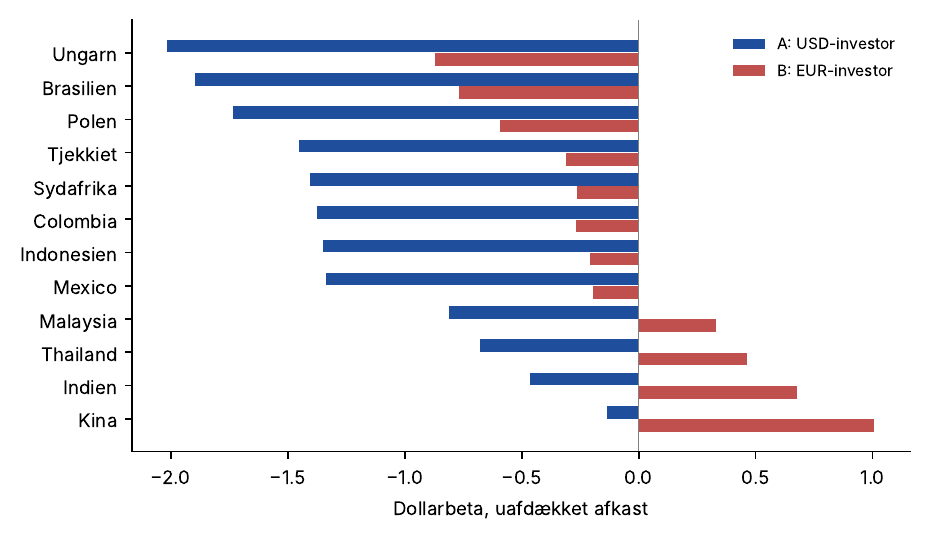
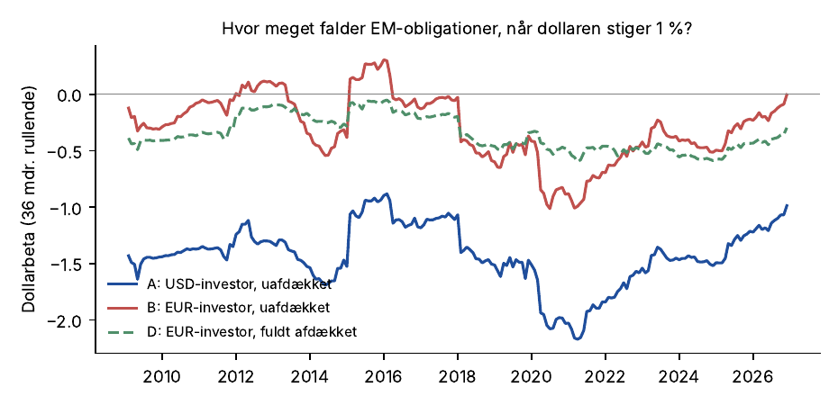

# Dollaren og EM-obligationer i lokalvaluta, version 2

📄 **Paper:** [`paper/EM_Paper_v2.pdf`](paper/EM_Paper_v2.pdf) · LaTeX-kilde: [`paper/EM_Paper_v2.tex`](paper/EM_Paper_v2.tex) · Version 1: tag [`v1.0`](https://github.com/ACP-dev1/dollar-em/tree/v1.0)

Albert Claes Poulsen, Økonomisk Institut, Københavns Universitet. Selvstændigt analyseprojekt, november 2026.

**Spørgsmål:** Hvor dollarfølsomme er emerging markets-obligationer i lokalvaluta i de enkelte lande, hvordan afhænger det af, om investoren måler sit afkast i dollar eller euro og afdækker valutaen, og kan afkastet forudsiges?

**Nyt i forhold til version 1:** Version 1 så på EMLC-fonden som helhed for en dollarinvestor og kunne kun opdele dollarfølsomheden i valuta og rente med en valutaproxy (CEW), der ikke matchede fondens lande. Version 2 konstruerer afkastet fra bunden for 12 lande, vægter dem med EMLC's faktiske historiske vægte og ser på fire investortyper.

## Hovedresultater

Vægtet aggregat, februar 2006 – november 2026 ($N = 250$). Dollarbeta = procentvis ændring i afkastet, når Feds dollarindeks (AFE) stiger 1 %.

| Investor | Dollarbeta | $t$ |
|---|---|---|
| A: USD-investor, uafdækket | −1,33 | −12,3 |
| B: EUR-investor, uafdækket | **−0,19** | −1,9 |
| C: EUR-investor i USD-hedged andelsklasse | **−1,33** | −12,4 |
| D: EUR-investor, fuldt afdækket | −0,32 | −4,8 |

- **Landene er meget forskellige:** dollarbetaen går fra −2,0 (Ungarn) og −1,9 (Brasilien) til −0,1 (Kina). Valutaen står for 76 % af følsomheden.
- **En uafdækket euroinvestor har næsten ingen dollarrisiko**, fordi euroen selv svækkes, når dollaren styrkes. En euroinvestor i en "EUR-hedged" andelsklasse har derimod den fulde dollarrisiko.
- **For euroinvestoren kommer dollarrisikoen fra Centraleuropa og Brasilien.** De asiatiske lande med styrede valutaer (Kina, Indien, Thailand, Malaysia) har positiv beta.
- **Markedet som helhed kan ikke times:** ingen model slår det historiske gennemsnit uden for stikprøven.
- **På tværs af lande:** at holde de fire EMLC-lande med det stærkeste kombinerede signal (carry, momentum og value) har givet 3,3 procentpoint mere om året end EMLC-porteføljen ($t = 2{,}39$). Det er dog ikke signifikant efter korrektion for, at fire signaler er testet, og det er koncentreret efter 2022.





## Hurtig start

Du kan læse paperet og alle tabeller uden at køre noget: [`paper/EM_Paper_v2.pdf`](paper/EM_Paper_v2.pdf) og [`resultater/`](resultater/).

For at genskabe resultaterne (Python 3.10+):

```bash
git clone https://github.com/ACP-dev1/dollar-em && cd dollar-em
python3 -m pip install -r requirements.txt

# 1. Gratis FRED-nøgle: fred.stlouisfed.org -> My Account -> API Keys
echo "DIN_FRED_NØGLE" > fred_key.txt

# 2. Renter fra investing.com (se "Data" nedenfor) i data/manuelt/

# 3. Hent data og byg afkast (ca. 2-5 minutter)
python3 hent_gratis_data.py

# 4. Kør analysen: tabeller, figurer og noegletal.json i resultater/
python3 analyse_v2.py

# 5. Kompilér paperet (valgfrit, kræver LaTeX)
cd paper && pdflatex EM_Paper_v2.tex && pdflatex EM_Paper_v2.tex
```

Ved senere kørsler genbruges de hentede rådata, så du ikke skal hente alt igen:

```bash
python3 hent_gratis_data.py --genbrug && python3 analyse_v2.py
```

**Test uden internet:** `python3 hent_gratis_data.py --demo` kører hele beregningen på syntetiske data med kendte betaer.

## Data

| Data | Kilde | Hentes |
|---|---|---|
| Spotkurser (11 valutaer + EUR/USD) | ECB's referencekurser | Automatisk |
| Spotkurs COP | Yahoo Finance | Automatisk |
| Dollarindeks (AFE og bredt), VIX, Brent, US-renter, tysk 10-årig | FRED (`DTWEXAFEGS`, `DTWEXBGS`, `VIXCLS`, ...) | Automatisk (kræver FRED-nøgle) |
| 10-årige renter: PLN, CZK, HUF, ZAR | OECD via FRED (`IRLTLT01..M156N`) | Automatisk |
| Styringsrenter (12 lande, USA, euroområdet) og reale effektive valutakurser | BIS | Automatisk |
| Råvarebytteforhold | IMF via DBnomics | Automatisk |
| EMLC og EMB (til validering) | Yahoo Finance, justeret for udlodninger | Automatisk |
| **10-årige renter: BRL, CNY, COP, IDR, INR, MXN, MYR, THB** | investing.com | **Manuelt**, se nedenfor |
| **EMLC's historiske valutavægte** | SEC: N-PORT (2019–2026), N-Q/N-CSR (2010–2019) | Ligger i repoet: [`data/manuelt/vaegte_historisk.csv`](data/manuelt/vaegte_historisk.csv) |

Alle serier måles ved månedens udgang.

### Renter fra investing.com

FRED har ikke de 10-årige renter for otte af landene. Data fra investing.com må ikke videredistribueres, så de ligger ikke i repoet. Sådan henter du dem (kræver gratis login):

1. Åbn fx [Brazil 10-Year Bond Yield Historical Data](https://www.investing.com/rates-bonds/brazil-10-year-bond-yield-historical-data).
2. Vælg **Time Frame: Monthly** og perioden 01/01/2003 – i dag, og klik **Download**.
3. Gem filen som `data/manuelt/yield10_BRL.csv`.

Gentag for `CNY` (China), `COP` (Colombia), `IDR` (Indonesia), `INR` (India), `MXN` (Mexico), `MYR` (Malaysia) og `THB` (Thailand). Scriptet læser investing.com's format direkte (første kolonne er dato, anden er renten).

Mangler en rentefil, springes landet over, og resultaterne afviger fra paperet. `data/gratis/log.csv` viser, hvilke serier der mangler.

### Valutavægte

`vaegte_historisk.csv` indeholder EMLC's valutafordeling på 51 tidspunkter (juli 2010 – juni 2026), opgjort ved at summere fondens beholdninger efter valuta i SEC-indberetningerne. Vægtene er normaliseret blandt de 12 lande. Hver måned bruges de senest kendte vægte, så der ikke er look-ahead. Uden filen bruges lige vægte.

## Metode

- **Afkast pr. land:** obligationsdel fra en 10-årig par-obligation + valutadel fra spotkursen. Opdelingen i valuta og rente er eksakt.
- **Fire investortyper:** USD uafdækket, EUR uafdækket, EUR i USD-hedged andelsklasse og EUR fuldt afdækket. Afdækning via styringsrenteforskellen.
- **Regressioner:** OLS med Newey-West-standardfejl (3 lags), AFE-dollarindeks som hovedspecifikation og det brede indeks som robusthed.
- **Robusthed:** delperioder, asymmetri (stigende/faldende dollar), kontrol for VIX, US-renter og olie.
- **Prognoser:** udvidende vindue (mindst 60 måneder), fortegnsbegrænsede koefficienter, Clark-West-test og økonomisk værdi (ΔCER). Holdout: 2022–2026.
- **Tværsnit:** månedlig rangering af landene efter carry, momentum og value. Sammenlignes med at holde EMLC-porteføljen (kontrafaktisk benchmark).

Prædiktorer, fortegn, estimationsvindue, holdout og strategiregler står øverst i `analyse_v2.py`. De blev fastlagt, før prognoserne blev kørt, men det er ikke dokumenteret med et tidsstempel.

## Struktur

```
hent_gratis_data.py             datahentning, afkastkonstruktion, vægtning
analyse_v2.py                   regressioner, robusthed, prognoser, strategier
requirements.txt                Python-pakker
data/manuelt/                   manuelle data (kun vaegte_historisk.csv ligger i repoet)
data/gratis/                    hentede rådata og afkast (genereres, ikke i repoet)
resultater/                     tabeller (.tex), figurer (.pdf/.png), noegletal.json
paper/EM_Paper_v2.tex           paperet; indlæser tabeller og figurer fra ../resultater/
paper/EM_Paper_v2.pdf           færdigt paper
```

## Fejlfinding

| Problem | Løsning |
|---|---|
| FRED-serier fejler med timeout | Læg din FRED-nøgle i `fred_key.txt`. Uden nøgle bruges FRED's CSV-download, som ofte blokerer automatiske kald |
| `SSL: CERTIFICATE_VERIFY_FAILED` på Mac | Kør `"/Applications/Python 3.13/Install Certificates.command"` én gang |
| Lande springes over | Mangler rentefil i `data/manuelt/`. Se `data/gratis/log.csv` |

## Begrænsninger

- Obligationsdelen bygger på én generisk 10-årig obligation pr. land, ikke en indekskurv. Valideret mod EMLC: korrelation 0,96, tracking error 3,3 procentpoint om året.
- Afdækning er beregnet med styringsrenter, ikke terminskurser, så afvigelser fra dækket renteparitet er ikke med.
- De 12 lande dækker 68–83 % af EMLC.
- Implicit valutavolatilitet og cross-currency basis kræver Bloomberg og er ikke med.
- Samtidige regressioner viser eksponering, ikke kausalitet.
