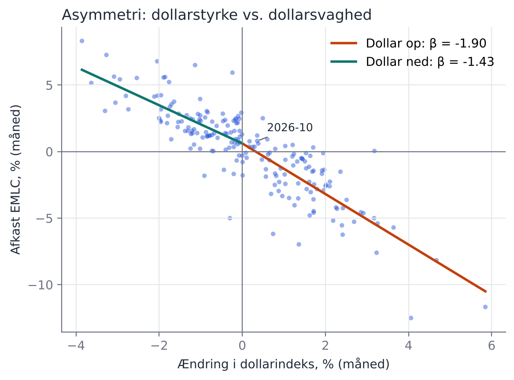
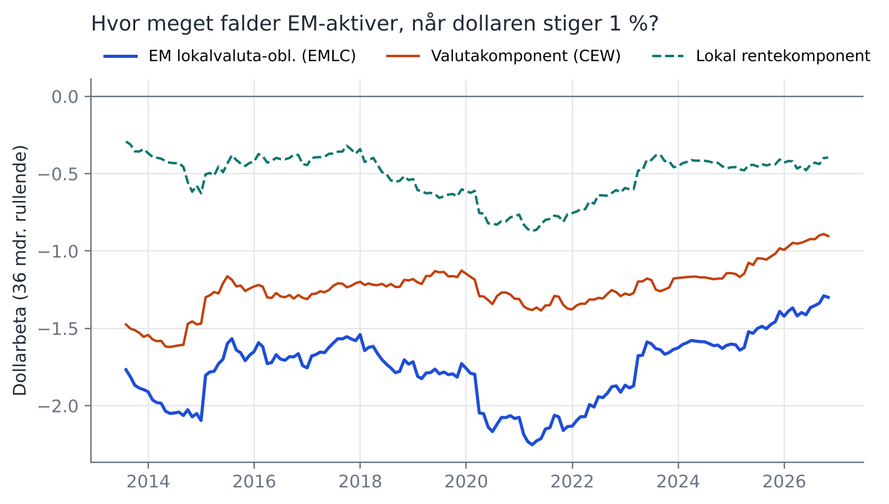

# Dollaren og EM-obligationer i lokalvaluta

*Genereret automatisk af `run.py`. Månedlige data 2010-08 til 2026-10, N = 195. Sidste måned (2026-10) er ufuldstændig og løber til 16-10-2026.
Newey-West standardfejl (3 lags). Alle afkast og ændringer i procent.*

## Hypoteser og domme

| | Hypotese (fastlagt før estimation på de rigtige data) | Dom |
|---|---|---|
| H1 | Dollarbetaen er negativ og signifikant for EMLC, CEW og EMB | **Understøttes** |
| H2 | Lokalvaluta (EMLC) er mere dollarfølsom end hård valuta (EMB) | **Understøttes** (forskel β = -0.65, t = -5.90) |
| H3 | Over halvdelen af EMLC's dollarbeta kommer fra valutaen | **Understøttes** (valutaandel 74 %) |
| H4 | Dollarstyrke gør mere ondt end dollarsvaghed gavner | **Understøttes ikke** (β op -1.90 vs. ned -1.43, p = 0.09) |
| H5 | Sidste måneds dollarændring forudsiger næste måneds EMLC-afkast out-of-sample | **Understøttes ikke** (R²_OOS = -1.51 %, CW p = 0.91) |
| H6 | Olie har en positiv effekt, og dollarbetaen overlever kontrol for olie og US-renter | **Understøttes ikke** |

## 1. Dollarbetaer

$r_{i,t} = \alpha_i + \beta_i \, \Delta \text{USD}_t + \varepsilon_{i,t}$

| aktiv                             |   beta |   se |      t |   p |   R2 |   N |
|:----------------------------------|-------:|-----:|-------:|----:|-----:|----:|
| EM lokalvaluta-obl. (EMLC)        |  -1.7  | 0.09 | -19.41 |   0 | 0.74 | 195 |
| EM-valutakurv (CEW)               |  -1.25 | 0.06 | -20.18 |   0 | 0.8  | 195 |
| Lokal rentekomponent (EMLC - CEW) |  -0.45 | 0.06 |  -7.88 |   0 | 0.29 | 195 |
| EM hård valuta (EMB)              |  -1.05 | 0.14 |  -7.28 |   0 | 0.42 | 195 |

### Med kontrol for olie og amerikansk 10-årig rente

$r_{i,t} = \alpha_i + \beta_i \, \Delta \text{USD}_t + \gamma_i \, \Delta \text{Olie}_t + \delta_i \, \Delta y^{US}_{10,t} + \varepsilon_{i,t}$

| aktiv                             |   beta |   se |      t |   p |   R2 |   N |   beta_d_oil |   t_d_oil |   beta_d_us10y |   t_d_us10y |
|:----------------------------------|-------:|-----:|-------:|----:|-----:|----:|-------------:|----------:|---------------:|------------:|
| EM lokalvaluta-obl. (EMLC)        |  -1.63 | 0.08 | -19.45 |   0 | 0.76 | 195 |         0.02 |      1.04 |          -2.02 |       -3.34 |
| EM-valutakurv (CEW)               |  -1.24 | 0.06 | -20.04 |   0 | 0.8  | 195 |         0.01 |      1.21 |           0.49 |        1.18 |
| Lokal rentekomponent (EMLC - CEW) |  -0.39 | 0.05 |  -8.39 |   0 | 0.45 | 195 |         0.01 |      0.9  |          -2.51 |       -6.03 |
| EM hård valuta (EMB)              |  -0.85 | 0.09 |  -9.31 |   0 | 0.64 | 195 |         0.06 |      2.14 |          -5.33 |       -9.87 |

## 2. Dekomponering: valuta eller rente?

Restposten er defineret som $r^{EMLC} - r^{CEW}$, så betaerne summerer per konstruktion. Det er en regneidentitet og ikke en validering. Det informative er, hvor følsom valutaandelen er over for valget af valutaproxy (se afsnit 7).

|                   |   værdi |
|:------------------|--------:|
| beta_EMLC         |  -1.699 |
| beta_valuta (CEW) |  -1.251 |
| beta_lokal rente  |  -0.448 |
| valutaandel       |   0.736 |

## 3. Asymmetri

$r_t = \alpha + \beta^{op} \max(\Delta \text{USD}_t, 0) + \beta^{ned} \min(\Delta \text{USD}_t, 0) + \varepsilon_t$

| aktiv                             |   beta_op |   t_op |   beta_ned |   t_ned |   p_ens |   mdr_op |   mdr_ned |
|:----------------------------------|----------:|-------:|-----------:|--------:|--------:|---------:|----------:|
| EM lokalvaluta-obl. (EMLC)        |     -1.9  | -11.48 |      -1.43 |   -9.31 |    0.09 |       91 |       104 |
| EM-valutakurv (CEW)               |     -1.4  | -14.92 |      -1.05 |  -10.45 |    0.03 |       91 |       104 |
| Lokal rentekomponent (EMLC - CEW) |     -0.5  |  -4    |      -0.38 |   -3.51 |    0.57 |       91 |       104 |
| EM hård valuta (EMB)              |     -1.34 |  -4.63 |      -0.68 |   -2.72 |    0.17 |       91 |       104 |

## 4. Rullende dollarbeta

## 5. Forudsigelse out-of-sample

Udvidende vindue, mindst 60 måneders træning. Benchmark er det historiske gennemsnit. Clark-West-test (ensidet).

| aktiv                             |   R2_OOS_pct |   CW_t |   CW_p |   N_oos |
|:----------------------------------|-------------:|-------:|-------:|--------:|
| EM lokalvaluta-obl. (EMLC)        |        -1.51 |  -1.36 |   0.91 |     134 |
| EM-valutakurv (CEW)               |        -2.79 |  -0.67 |   0.75 |     134 |
| Lokal rentekomponent (EMLC - CEW) |        -0.41 |   0.03 |   0.49 |     134 |
| EM hård valuta (EMB)              |        -0.97 |  -0.98 |   0.84 |     134 |

## 6. Den seneste episode: modellen estimeret uden de sidste 3 måneder

|                                           |   d_dollar |   faktisk |   model |   afvigelse |
|:------------------------------------------|-----------:|----------:|--------:|------------:|
| ('2026-08', 'EM lokalvaluta-obl. (EMLC)') |      -0.95 |      1.06 |    1.73 |       -0.67 |
| ('2026-09', 'EM lokalvaluta-obl. (EMLC)') |       2.01 |     -2.58 |   -3.56 |        0.98 |
| ('2026-10', 'EM lokalvaluta-obl. (EMLC)') |       0.36 |      0.8  |    0.19 |        0.61 |
| ('2026-08', 'EM-valutakurv (CEW)')        |      -0.95 |      0.66 |    1.36 |       -0.71 |
| ('2026-09', 'EM-valutakurv (CEW)')        |       2.01 |     -1.22 |   -1.85 |        0.63 |
| ('2026-10', 'EM-valutakurv (CEW)')        |       0.36 |      0.56 |   -0.31 |        0.87 |
| ('2026-08', 'EM hård valuta (EMB)')       |      -0.95 |      0.55 |    0.8  |       -0.25 |
| ('2026-09', 'EM hård valuta (EMB)')       |       2.01 |     -3.8  |   -2.47 |       -1.33 |
| ('2026-10', 'EM hård valuta (EMB)')       |       0.36 |      1.24 |    1.41 |       -0.18 |

## 7. Robusthed og eksplorative analyser (ikke forhåndsfastlagt)

### Dollarindeks uden EM-valutaer

Feds brede indeks indeholder bl.a. yuan og peso. Indekset mod avancerede økonomier (`DTWEXAFEGS`) gør ikke.

| aktiv               |   beta_bred |   t_bred |   R2_bred |   beta_afe |   t_afe |   R2_afe |
|:--------------------|------------:|---------:|----------:|-----------:|--------:|---------:|
| EMLC                |       -1.7  |   -19.41 |      0.74 |      -1.27 |  -13.18 |     0.55 |
| CEW                 |       -1.25 |   -20.18 |      0.8  |      -0.95 |  -13.05 |     0.61 |
| Spotkurv (7 GBI-EM) |       -1.13 |   -21.13 |      0.79 |      -0.83 |  -13.14 |     0.56 |
| EMLC - CEW          |       -0.45 |    -7.88 |      0.29 |      -0.32 |   -7.13 |     0.19 |
| EMLC - spotkurv     |       -0.56 |   -11.82 |      0.36 |      -0.44 |   -9.93 |     0.29 |
| EMB                 |       -1.05 |    -7.28 |      0.42 |      -0.77 |   -6.98 |     0.3  |

### Valutaproxy: CEW mod spotkurv

Spotkurven er ligevægtet over de syv GBI-EM-valutaer, Fed offentliggør (BRL, MXN, ZAR, INR, CNY, MYR, THB), og indeholder ingen carry.

| valutaproxy                     |   beta_valuta |   beta_rest |   t_rest |   valutaandel |   korr_med_EMLC |
|:--------------------------------|--------------:|------------:|---------:|--------------:|----------------:|
| CEW (ligevægtet, inkl. carry)   |         -1.25 |       -0.45 |    -7.88 |          0.74 |            0.93 |
| Spotkurv (7 GBI-EM, uden carry) |         -1.13 |       -0.56 |   -11.82 |          0.67 |            0.92 |

### Asymmetri med kontrol for VIX

|                                |   beta_op |   beta_ned |   forskel |   p_ens |
|:-------------------------------|----------:|-----------:|----------:|--------:|
| ('EMLC', 'nej')                |     -1.9  |      -1.43 |     -0.47 |    0.09 |
| ('EMLC', 'ja')                 |     -1.79 |      -1.37 |     -0.42 |    0.12 |
| ('CEW', 'nej')                 |     -1.4  |      -1.05 |     -0.35 |    0.03 |
| ('CEW', 'ja')                  |     -1.3  |      -1    |     -0.3  |    0.05 |
| ('Spotkurv (7 GBI-EM)', 'nej') |     -1.29 |      -0.93 |     -0.36 |    0.01 |
| ('Spotkurv (7 GBI-EM)', 'ja')  |     -1.25 |      -0.91 |     -0.34 |    0.02 |

## Begrænsninger

- Hverken CEW eller spotkurven matcher EMLC's landevægte. Restposten opsamler derfor både lokal rente, vægtforskel og (for CEW) carry. En ren opdeling kræver J.P. Morgan GBI-EM i både hedget og uhedget version.
- CEW handles sjældent og har uændrede slutkurser i nogle måneder, hvilket trækker dens beta mod nul.
- ETF'er har gebyrer og tracking error i forhold til de underliggende J.P. Morgan-indeks.
- Asymmetri-resultatet for CEW og VIX-kontrollen er eksplorative og var ikke fastlagt på forhånd.
- Hypoteserne blev skrevet, før analysen blev kørt på de rigtige data, men det er ikke dokumenteret med tidsstempler.
- Samtidige regressioner viser eksponering, ikke kausalitet. Dollaren og EM-aktiver reagerer begge på global risikovillighed.
